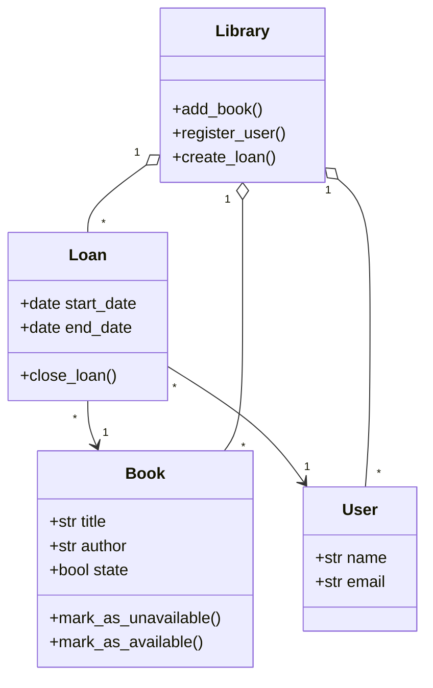

# UML Intro — Library Loan System

## About the project
This project is my first step into software modeling with UML. The goal is to read a problem description and translate it into a **Mermaid class diagram** without adding anything that isn't in the text.

## The problem (summary)
A small library wants to manage its books and users. The system revolves around a `Library` that manages books, users, and loans. When a user borrows a book, a `Loan` is created.

## Repository structure
```
holbertonschool-sw_design_architecture/
└── uml_intro/
    ├── 0-class_diagram.mmd
    └── README.md
```

| File | Description |
|---|---|
| `0-class_diagram.mmd` | Mermaid class diagram of the system |

## Requirements
- Ubuntu 20.04
- A Mermaid-compatible renderer (e.g. [mermaid.live](https://mermaid.live))
- Python-style data types (`str`, `bool`, `date`)
- File and element names must match the problem statement exactly

## The diagram



## Design decisions

**Classes, attributes, and methods** are taken directly from the problem statement. `Library` has no attributes because none are described.

**Association (`-->`) between `Loan` and `Book` / `User`**
- A `Loan` cannot exist without a book and a user (it must *reference* them).
- A `Book` or `User` can exist without any loans.
- Each `Loan` has exactly one `Book` and one `User` (`1`); a `Book` or `User` can have many loans over time (`*`).

**Aggregation (`o--`) between `Library` and `Book` / `User` / `Loan`**
- The `Library` *manages* all three.
- If the `Library` is removed, books and users still exist independently, so this is aggregation and not composition.
- One `Library` manages many of each (`1` to `*`).

## How to view the diagram
1. Open [mermaid.live](https://mermaid.live).
2. Paste the contents of `0-class_diagram.mmd`.
3. Check that it renders without errors.

## Key concepts practiced
| Relationship | Symbol | Question to ask |
|---|---|---|
| Association | `-->` | Does one class reference the other? |
| Aggregation | `o--` | Does it contain the other, but the part can live on its own? |
| Composition | `*--` | If the whole is destroyed, is the part destroyed too? |
